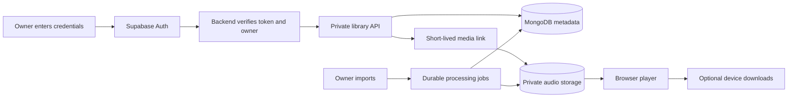

# AetherCast implementation plan

Drafted 2026-11-05 from [REFERENCE_RESEARCH.md](REFERENCE_RESEARCH.md) and the current workspace. This is a proposal, not automatic adoption of Echo, LastWave or Velune. The owner and implementer retain final decisions and can change priorities. External code, README promises and design choices do not override our requirements.

## Product direction and decisions

Build a private, ad-free music app for the owner's library, with optional podcasts. Keep React/Vite, Express, MongoDB and Supabase unless a demonstrated requirement justifies replacing a component. Maintain explicit current-credential sign-in on every new page session; internal navigation can continue within an authorized session. Do not reintroduce automatic owner login to mimic a reference app.

| Topic | Proposed choice | Decision state |
| --- | --- | --- |
| Initial song source | Owner imports, private originals and optional approved personal-server connections later | Imports/private library already selected; adding a connector remains open |
| Global online catalog | Separate supported-source investigation, isolated from the private library | Open; no YouTube/other provider selected or enabled by this plan |
| Interface | Original artwork-led library/player, desktop sidebar and mobile navigation; clear source and download states | Recommended; review the current draft interface together |
| AI | Start with local, explainable recommendation rules; optional remote-model features later | Recommended; providers, budget and data sharing remain open |
| Offline cold launch | Continue requiring online credential verification on a fresh page | Existing owner requirement; an offline-unlock exception needs an explicit later decision |
| Native mobile app | Complete the web/PWA experience first | Recommended; revisit if browser limitations block daily use |

## Current implementation baseline

Committed foundations include owner authentication, in-memory explicit credential sessions, private media links, separate Artist/Album/Track/MediaAsset models, background imports with metadata review, music browsing and basic track playback. The queue still uses track identity and is built from the displayed page of up to 50 tracks. Music likes/playlists/history/downloads and shuffle/repeat remain unfinished. Podcast features retain their own models and APIs.

The workspace also contains an uncommitted Echo-inspired interface draft recorded as Change 13 in `NEEDED_CAHNGES.MD`, including new navigation, artwork components and expanded Now Playing/queue views. Treat that as work in progress until its own review/verification/commit. This planning batch preserves those changes and does not claim they are deployed or delivered by this commit.

Existing podcast AI endpoints contain conditional Gemini calls; no new music AI service has been implemented or validated. Existing media capabilities retain their documented expiry. Live sign-in, storage and device verification still need evidence after deployment.

## Storage and source architecture

| Information | Proposed home | Purpose |
| --- | --- | --- |
| Owner identity and password verification | Supabase Auth | Verify current credentials; backend verifies owner tokens |
| Tracks, artists, albums, playlists, likes, history, import jobs | MongoDB | Owner-scoped durable metadata and relationships |
| Original audio, cover originals, future encoded versions | Private Supabase Storage | Durable media objects; playback uses short-lived links |
| Download index, local catalog snapshots, pending sync operations | IndexedDB, when implemented | Structured device state without persisting login tokens |
| Downloaded audio and artwork | Owner-scoped Cache Storage initially | Device copies, availability checks, quotas and cleanup |
| Small non-sensitive display preferences | Browser localStorage if useful | Theme and interface preferences; no passwords or bearer tokens |
| Recommendation signals | MongoDB events with optional device summaries | Reproducible mixes without compulsory external AI |

An optional future source adapter should expose search, metadata resolution, playable-source resolution and supported capabilities. Store stable provider IDs separately from expiring URLs. Keep provider credentials server-side. Imported originals remain the reliable default, and external lookup must not silently replace them or add songs without a deliberate import/save action. Browser requests must not proxy arbitrary user-supplied URLs.

Rough capacity examples, not hosting prices: 1,000 four-minute songs at 128 kbps contain about 3.84 GB of audio; at 320 kbps, about 9.6 GB, before artwork/backups/derivatives. One hour at those bitrates transfers roughly 57.6 MB or 144 MB respectively. Lossless size varies considerably. Measure real files and usage before choosing storage/bandwidth capacity; source quality cannot be increased by relabeling a transcoded file.

## Phase 0 — Confirm the foundation and review the interface draft

1. Deploy the existing authentication/profile/proxy changes together with the matching frontend. Check correct owner login, wrong credentials, guest/non-owner denial, reload/new-tab locking and logout. Do not use a hardcoded password or a persistent owner token.
2. Verify actual private-bucket behavior, imported originals, database indexes and transaction support, worker recovery and current playback seeking. Take a database/media backup and document a restore drill.
3. Review the existing Change 13 draft on desktop/phone: navigation, real imported records, Now Playing, queue visibility, keyboard focus, Escape, broken artwork and reduced motion. Resolve any findings before committing that UI batch.
4. Separate optional podcast/tool actions from everyday music use; remove music-facing simulated purchase/upgrade friction while preserving old data.

**Acceptance:** a fresh device sees login; the owner imports one album, reviews tags and plays a track; a guest cannot retrieve catalog/audio through the ordinary app flow; no invented quality/recommendation data is shown. Record hosted evidence separately from unit tests. This phase gates later daily-use feature work.

## Phase 1 — Complete playback queue behavior

**Proposed implementation:** add a focused queue reducer/module under `frontend/src/lib/`, adapt `PlayerContext.jsx`, and extend `MusicPlayer.jsx` rather than putting queue logic inside UI event handlers.

- Represent each occurrence with a unique `queueItemId`, plus `trackId`, source context and insertion order. Playing the same track twice must not confuse active identity, next/previous or removal.
- Separate manually added next-up items from the remaining album/playlist context. Add Play Next, Add to Queue, remove, clear, reorder and jump-to-item actions.
- Load full album/playlist context through bounded pagination; preserve disc/track or playlist order rather than stopping at the visible 50-row page. Define behavior when the underlying catalog changes during paging.
- Implement shuffle with a stable shuffled sequence and actual previous-play history. Implement repeat off/all/one and clear end-of-queue behavior.
- Keep the existing stale-selection counter, fresh media resolution, error recovery and owner checks. Songs restart at zero on a new selection; a media-link retry preserves the current position where available.
- Persist only non-secret queue state when useful. Restore it after the next successful credential sign-in, without autoplay and without restoring authentication.

**Acceptance:** repeated-track queues, last-item completion, rapid selection, shuffle history, each repeat mode, removing/reordering the active item, unavailable tracks and a 100+ track album behave predictably. Logout/page locking stops playback and invalidates pending selections.

## Phase 2 — Add the personal music library

**Proposed backend records:** separate `TrackLike`, `SavedAlbum`, `FollowedArtist`, `MusicPlaylist`, `MusicPlaylistItem` and `ListeningEvent` collections. These are proposed additions, not existing models. Every record/query uses the immutable MongoDB owner ID.

- Likes/saves/follows use suitable owner/reference uniqueness; do not append music IDs into episode-like fields.
- Playlist items have their own IDs and explicit order, allowing repeated track occurrences. Use version checks for conflicting edits and transactions where a reorder spans records.
- Add playlist create/rename/delete, add/remove/reorder and unavailable-track handling. Soft-deleted tracks remain identifiable without silently destroying history or playlist order.
- Record real play/start/skip/completion events with idempotency keys, bounded retention and correct media identity. Avoid unbounded user-document arrays and duplicate events on retries.
- Build Liked Songs, saved collections, music playlists, recently played and basic private listening statistics using real records only.

**Acceptance:** a liked song and playlist survive re-login and appear on another authorized device; repeated songs keep distinct positions; concurrent edits report/recover conflicts; non-owner requests are rejected; deleting a track retains recoverable references.

## Phase 3 — Search and finish everyday browsing

- Expand song-title search into grouped track/artist/album/playlist results, with appropriate owner-scoped indexes and bounded pagination.
- Offer useful sorts/filters such as artist, album, date added, duration and downloaded state as those fields become available. Cancel stale searches and preserve browser navigation.
- Add album/artist details and contextual library/queue actions. Make import status, missing files, unavailable audio and retry actions explicit.
- Keep artwork responsive, with generated sizes and placeholders, verified focus/touch targets and adequate spacing above the mini-player/mobile navigation.

**Acceptance:** realistic large-library queries stay bounded, late results never replace a newer query, title/artist/album cases are covered, and keyboard/phone workflows can perform common queue/library actions.

## Phase 4 — Lyrics and explainable recommendations

- First accept owner-supplied LRC/plain-text lyrics, associated with the correct track and optional offsets. Synchronized lyric display must handle seeking, instrumental tracks, missing lyrics and reduced motion.
- Add a provider interface only if external lyrics lookup is chosen; report source/availability and cache appropriately. Do not confuse lyrics retrieval with audio retrieval.
- Build a local recommendation score from real listening time, likes, genres, recency and skips. Include exclusions, novelty/diversity controls and a short explanation for each mix.
- Populate mixes only from owned/available track IDs by default. New accounts should see honest empty/fallback states instead of fabricated personalized mixes.

**Acceptance:** imported lyrics follow seeks correctly; excluded tracks stay excluded; recommendation order is reproducible/testable and uses available media; core listening does not require a model API key.

## Phase 5 — Music downloads and mobile playback

- Extend identity-safe downloads to tracks with an IndexedDB index, owner-scoped audio/artwork caches, integrity/availability checks, progress, retries/cancel, storage budgets and eviction reporting.
- Distinguish disposable streaming cache from user-requested downloads. Clearing streaming cache must not silently remove explicit downloads.
- Preserve logout cleanup and define retention clearly. Queue progress/history writes for later sync only within the selected authentication policy.
- Add Media Session metadata/actions and test Android/iOS lock screen, headphones, backgrounding, interruption, network loss and seeking. Browser restrictions require real device results, not Android feature parity claims.

**Authentication constraint:** with fresh online password verification required on every new page visit, a fully cold offline launch cannot authenticate. Support network-loss playback inside an already approved running page first. Offering a device-bound offline-unlock exception is a separate owner decision; do not silently persist access/refresh tokens to get around this requirement.

**Acceptance:** verified complete music downloads play/seek during network loss in an authorized running page; partial/evicted downloads show accurate state; quotas/cancellation work; logout removes access; a new offline page remains locked under the current policy.

## Phase 6 — Media processing and audio quality

- Add durable derivative jobs for browser-compatible formats where originals cannot play, with codec/version/checksum/technical metadata and separate original links.
- Generate artwork thumbnails; add safe cleanup/retention for cancelled jobs, abandoned objects and deleted/replaced media without deleting referenced originals.
- Surface actual source/format/bitrate information and quality choices only when variants exist. Evaluate loudness analysis/normalization, gapless and crossfade independently with representative files/devices.
- Verify playback-link renewal, long streams, range behavior, job interruption, storage costs and backup restoration before claiming dependable premium playback.

**Acceptance:** unsupported originals gain a verified playable derivative, originals remain intact, retries do not duplicate records, quality labels match files, and cleanup cannot remove referenced media.

## Phase 7 — Optional integrations and AI

Choose each item separately; none is a prerequisite for finishing Phases 1–5.

| Option | Candidate behavior | Required decision/check |
| --- | --- | --- |
| Personal media server | Jellyfin or Navidrome adapter for the owner's existing server | Which server, authentication/storage model, reachability, source identity and backup ownership |
| External discovery/catalog | Search/preview or another supported provider integration | Source capabilities, account requirements, availability, browser behavior and permitted media use; no automatic catalog adoption |
| Metadata enrichment | Optional artist/album/artwork/identifier lookup with an editable preview | Chosen provider, matching accuracy, attribution and handling of unavailable results |
| Remote AI | Mood-to-library playlist drafting or optional lyric translation | Provider/model, spend cap, privacy, current API availability and explicit enable/disable behavior |
| Native app | More dependable OS media integration or local-folder access | Demonstrated browser limitation and maintenance cost before a Kotlin rewrite |

If remote AI is selected, call it from the backend, keep keys off the frontend, bound spend/time/retries and validate all returned IDs against the owner's available library. Show a draft playlist before saving; an LLM must not invent playable tracks or act as the audio store. Treat lyrics/metadata as untrusted input. Do not send the owner's full history or raw audio by default. Update the existing podcast model configuration separately rather than assuming its hardcoded model is available.

## Working process and next concrete batch

Track implementation in `NEEDED_CAHNGES.MD`; this plan links to that checklist instead of creating a competing “done” list. For each batch, record changes, meaningful tests, remaining setup, and verified versus unverified hosted behavior; commit/push only the batch's own files. Preserve unrelated work in progress. Reference source is read-only research; original implementation remains the default, with any source reuse reviewed separately.

Recommended next feature batch after Phase 0: **queue occurrence IDs, full-album context, next-up/add/remove/reorder, shuffle and repeat**, before adding AI or more source providers. This improves every imported album and supplies the queue foundation that playlists need. The owner can choose to prioritize likes/playlists instead; this is a recommendation, not a binding final decision.
