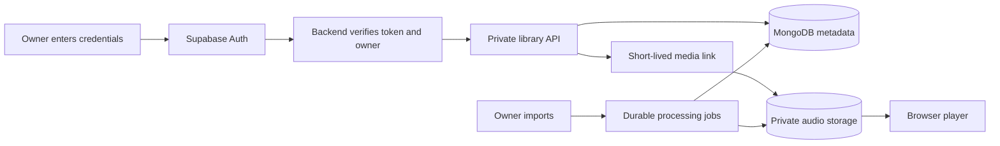

# AetherCast implementation plan

Drafted 2026-11-05 from [REFERENCE_RESEARCH.md](REFERENCE_RESEARCH.md) and the current workspace. This is a proposal, not automatic adoption of Echo, LastWave or Velune. The owner and implementer retain final decisions and can change priorities. External code, README promises and design choices do not override our requirements.

Owner update on 2026-11-05: proceed with the recommended sequence, excluding offline/download development for now. Offline work is deferred and is not an active phase or release requirement. Existing episode-download behavior is retained.

## Product direction and decisions

Build a private, ad-free music app for the owner's library, with optional podcasts. Keep React/Vite, Express, MongoDB and Supabase unless a demonstrated requirement justifies replacing a component. Maintain explicit current-credential sign-in on every new page session; internal navigation can continue within an authorized session. Do not reintroduce automatic owner login to mimic a reference app.

| Topic | Proposed choice | Decision state |
| --- | --- | --- |
| Initial song source | Owner imports, private originals and optional approved personal-server connections later | Imports/private library already selected; adding a connector remains open |
| Global online catalog | Separate supported-source investigation, isolated from the private library | Open; no YouTube/other provider selected or enabled by this plan |
| Interface | Original artwork-led library/player, desktop sidebar and mobile navigation; clear source and download states | Recommended; review the current draft interface together |
| AI | Start with local, explainable recommendation rules; optional remote-model features later | Recommended; providers, budget and data sharing remain open |
| Native mobile app | Complete the web/PWA experience first | Recommended; revisit if browser limitations block daily use |

## Current implementation baseline

Foundations include owner authentication, in-memory explicit credential sessions, private media links, separate Artist/Album/Track/MediaAsset models, background imports with metadata review, music browsing and track playback. Change 14 adds an occurrence-based editable queue, complete paginated contexts up to 2,000 songs, shuffle and repeat. Change 15 adds music likes, saved albums, followed artists, versioned playlists and listening history; aggregate statistics remain future work. Offline/download development is deferred. Podcast features retain their own models and APIs.

The Echo-inspired interface recorded as Change 13 in `NEEDED_CAHNGES.MD` includes new navigation, artwork components and expanded Now Playing/queue views. Change 14 integrates and verifies that draft with the queue implementation. Hosted desktop/phone verification is still required; local builds/tests do not establish deployment success.

Existing podcast AI endpoints contain conditional Gemini calls; no new music AI service has been implemented or validated. Existing media capabilities retain their documented expiry. Live sign-in, storage and device verification still need evidence after deployment.

## Storage and source architecture

| Information | Proposed home | Purpose |
| --- | --- | --- |
| Owner identity and password verification | Supabase Auth | Verify current credentials; backend verifies owner tokens |
| Tracks, artists, albums, playlists, likes, history, import jobs | MongoDB | Owner-scoped durable metadata and relationships |
| Original audio, cover originals, future encoded versions | Private Supabase Storage | Durable media objects; playback uses short-lived links |
| Small non-sensitive display preferences | Browser localStorage if useful | Theme and interface preferences; no passwords or bearer tokens |
| Recommendation signals | MongoDB events with optional device summaries | Reproducible mixes without compulsory external AI |

An optional future source adapter should expose search, metadata resolution, playable-source resolution and supported capabilities. Store stable provider IDs separately from expiring URLs. Keep provider credentials server-side. Imported originals remain the reliable default, and external lookup must not silently replace them or add songs without a deliberate import/save action. Browser requests must not proxy arbitrary user-supplied URLs.

Rough capacity examples, not hosting prices: 1,000 four-minute songs at 128 kbps contain about 3.84 GB of audio; at 320 kbps, about 9.6 GB, before artwork/backups/derivatives. One hour at those bitrates transfers roughly 57.6 MB or 144 MB respectively. Lossless size varies considerably. Measure real files and usage before choosing storage/bandwidth capacity; source quality cannot be increased by relabeling a transcoded file.

## Phase 0 — Confirm the foundation and review the interface draft

1. Deploy the existing authentication/profile/proxy changes together with the matching frontend. Check correct owner login, wrong credentials, guest/non-owner denial, reload/new-tab locking and logout. Do not use a hardcoded password or a persistent owner token.
2. Verify actual private-bucket behavior, imported originals, database indexes and transaction support, worker recovery and current playback seeking. Take a database/media backup and document a restore drill.
3. Review the existing Change 13 draft on desktop/phone: navigation, real imported records, Now Playing, queue visibility, keyboard focus, Escape, broken artwork and reduced motion. Resolve any findings before committing that UI batch.
4. Separate optional podcast/tool actions from everyday music use; remove music-facing simulated purchase/upgrade friction while preserving old data.

**Acceptance:** a fresh device sees login; the owner imports one album, reviews tags and plays a track; a guest cannot retrieve catalog/audio through the ordinary app flow; no invented quality/recommendation data is shown. Record hosted evidence separately from unit tests. This phase gates later daily-use feature work.

## Phase 1 — Complete playback queue behavior (implemented core; restoration remains future work)

**Proposed implementation:** add a focused queue reducer/module under `frontend/src/lib/`, adapt `PlayerContext.jsx`, and extend `MusicPlayer.jsx` rather than putting queue logic inside UI event handlers.

- Represent each occurrence with a unique `queueItemId`, plus `trackId`, source context and insertion order. Playing the same track twice must not confuse active identity, next/previous or removal.
- Separate manually added next-up items from the remaining album/playlist context. Add Play Next, Add to Queue, remove, clear, reorder and jump-to-item actions.
- Load full album/playlist context through bounded pagination; preserve disc/track or playlist order rather than stopping at the visible 50-row page. Define behavior when the underlying catalog changes during paging.
- Implement shuffle with a stable shuffled sequence and actual previous-play history. Implement repeat off/all/one and clear end-of-queue behavior.
- Keep the existing stale-selection counter, fresh media resolution, error recovery and owner checks. Songs restart at zero on a new selection; a media-link retry preserves the current position where available.
- Future follow-up: persist only non-secret queue state when useful, restoring it after the next successful credential sign-in without autoplay or authentication restoration. Current queues stay in memory and clear on logout/page locking.

**Acceptance:** repeated-track queues, last-item completion, rapid selection, shuffle history, each repeat mode, removing/reordering the active item, unavailable tracks and a 100+ track album behave predictably. Logout/page locking stops playback and invalidates pending selections.

## Phase 2 — Add the personal music library (core implemented; hosted acceptance pending)

**Implemented records:** separate `TrackLike`, `SavedAlbum`, `FollowedArtist`, `MusicPlaylist` and `ListeningEvent` collections. Playlist items use bounded ordered subdocuments with stable IDs instead of the initially proposed separate `MusicPlaylistItem` collection. A version-checked single-document update makes reorder atomic without a cross-record transaction. Every record/query uses the immutable MongoDB owner ID. See [MUSIC_COLLECTIONS.md](MUSIC_COLLECTIONS.md) for API, retention and delivery limits.

- Likes/saves/follows use suitable owner/reference uniqueness; do not append music IDs into episode-like fields.
- Playlist items have their own IDs and explicit order, allowing repeated track occurrences. Use version checks for conflicting edits and transactions where a reorder spans records.
- Add playlist create/rename/delete, add/remove/reorder and unavailable-track handling. Soft-deleted tracks remain identifiable without silently destroying history or playlist order.
- Record real play/start/skip/completion events with idempotency keys, bounded retention and correct media identity. Avoid unbounded user-document arrays and duplicate events on retries.
- Build Liked Songs, saved collections, music playlists and recently played using real records only. These views and per-session elapsed listening are implemented; aggregate statistics remain future work.

**Acceptance:** a liked song and playlist survive re-login and appear on another authorized device; repeated songs keep distinct positions; concurrent edits report/recover conflicts; non-owner requests are rejected; deleting a track retains recoverable references.

## Phase 3 — Search and finish everyday browsing (grouped search core implemented; hosted acceptance pending)

Change 16 adds grouped owner-only title/name search, category pagination, query/sort/navigation state, contextual library/queue actions and shortest-first song browsing. See [MUSIC_SEARCH.md](MUSIC_SEARCH.md) for matching semantics, execution bounds and verification. Existing album/artist song filters remain; richer detail headers, generated artwork sizes and real-device/large-library verification remain follow-ups.

- Expand song-title search into grouped track/artist/album/playlist results, with appropriate owner-scoped indexes and bounded pagination.
- Offer useful sorts/filters such as artist, album, date added, duration and downloaded state as those fields become available. Cancel stale searches and preserve browser navigation.
- Add album/artist details and contextual library/queue actions. Make import status, missing files, unavailable audio and retry actions explicit.
- Keep artwork responsive, with generated sizes and placeholders, verified focus/touch targets and adequate spacing above the mini-player/mobile navigation.

**Acceptance:** realistic large-library queries stay bounded, late results never replace a newer query, title/artist/album cases are covered, and keyboard/phone workflows can perform common queue/library actions.

## Phase 4 — Lyrics and explainable recommendations (owner-supplied/local core implemented; hosted acceptance pending)

Change 17 implements versioned owner-supplied plain/LRC lyrics with offsets and synchronized seeking, plus deterministic library mixes with reasons and song/artist exclusions. No external provider is enabled. See [MUSIC_PERSONALIZATION.md](MUSIC_PERSONALIZATION.md) for API, scoring, bounds and rollout. Browser/device and hosted database acceptance remain pending; advanced lyrics, scoring settings and larger-library support are follow-ups.

- First accept owner-supplied LRC/plain-text lyrics, associated with the correct track and optional offsets. Synchronized lyric display must handle seeking, instrumental tracks, missing lyrics and reduced motion.
- Add a provider interface only if external lyrics lookup is chosen; report source/availability and cache appropriately. Do not confuse lyrics retrieval with audio retrieval.
- Build a local recommendation score from real listening time, likes, genres, recency and skips. Include exclusions, novelty/diversity controls and a short explanation for each mix.
- Populate mixes only from owned/available track IDs by default. New accounts should see honest empty/fallback states instead of fabricated personalized mixes.

**Acceptance:** imported lyrics follow seeks correctly; excluded tracks stay excluded; recommendation order is reproducible/testable and uses available media; core listening does not require a model API key.

## Phase 5 — Mobile streaming and device controls (supported-browser core implemented; real-device acceptance pending)

Change 18 adds feature-detected music Media Session labels/actions/position, immediate lock/logout cleanup and explicit retry-position recovery with cancellable source lookups. See [MUSIC_DEVICE_CONTROLS.md](MUSIC_DEVICE_CONTROLS.md). Local simulated-API tests pass; lock-screen, Bluetooth, interruption and background behavior remain unverified on actual devices. No offline subsystem is introduced.

- Add Media Session metadata/actions and test Android/iOS lock screen, headphones, backgrounding, interruption and seeking. Browser restrictions require real device results, not Android feature parity claims.
- Verify clear playback failures and authorized retry after connectivity interruptions, without adding a music download/offline subsystem.
- Keep fresh credential verification on a new visit; do not persist authentication tokens for convenience.

**Acceptance:** online music playback, supported lock-screen controls, interruption/retry, seeking and logout work on tested phones. Offline launch, new music downloads and offline synchronization are excluded from the active plan.

## Phase 6 — Media processing and audio quality (conversion/thumbnail and expiry-recovery core implemented; quality/cleanup/hosted follow-ups remain)

Change 19 adds on-demand leased conversion/thumbnail jobs, preserved originals, explicit original/compatible playback, measured technical labels, bounded FFmpeg execution and a Docker deployment option. See [MUSIC_PROCESSING.md](MUSIC_PROCESSING.md). FFmpeg provisioning and hosted/device acceptance remain pending. Normalization, advanced transitions, seamless link renewal and permanent retained-object cleanup remain follow-ups within this phase.

- Add durable derivative jobs for browser-compatible formats where originals cannot play, with codec/version/checksum/technical metadata and separate original links.
- Generate artwork thumbnails; add safe cleanup/retention for cancelled jobs, abandoned objects and deleted/replaced media without deleting referenced originals.
- Surface actual source/format/bitrate information and quality choices only when variants exist. Evaluate loudness analysis/normalization, gapless and crossfade independently with representative files/devices.
- Verify playback-link renewal, long streams, range behavior, job interruption, storage costs and backup restoration before claiming dependable premium playback.

**Acceptance:** unsupported originals gain a verified playable derivative, originals remain intact, retries do not duplicate records, quality labels match files, and cleanup cannot remove referenced media.

## Phase 7 — Optional integrations and AI

Choose each item separately; none is a prerequisite for finishing Phases 1–5.

| Option | Candidate behavior | Required decision/check |
| --- | --- | --- |
| Personal media server | Jellyfin or Navidrome adapter for the owner's existing server | Which server, authentication/storage model, reachability, source identity and backup ownership |
| External discovery/catalog | Search/preview or another supported provider integration | Source capabilities, account requirements, availability, browser behavior and permitted media use; no automatic catalog adoption |
| Metadata enrichment | Optional artist/album/artwork/identifier lookup with an editable preview | Chosen provider, matching accuracy, attribution and handling of unavailable results |
| Remote AI | Mood-to-library playlist drafting or optional lyric translation | Provider/model, spend cap, privacy, current API availability and explicit enable/disable behavior |
| Native app | More dependable OS media integration or local-folder access | Demonstrated browser limitation and maintenance cost before a Kotlin rewrite |

If remote AI is selected, call it from the backend, keep keys off the frontend, bound spend/time/retries and validate all returned IDs against the owner's available library. Show a draft playlist before saving; an LLM must not invent playable tracks or act as the audio store. Treat lyrics/metadata as untrusted input. Do not send the owner's full history or raw audio by default. Update the existing podcast model configuration separately rather than assuming its hardcoded model is available.

## Working process and next concrete batch

Track implementation in `NEEDED_CAHNGES.MD`; this plan links to that checklist instead of creating a competing “done” list. For each batch, record changes, meaningful tests, remaining setup, and verified versus unverified hosted behavior; commit/push only the batch's own files. Preserve unrelated work in progress. Reference source is read-only research; original implementation remains the default, with any source reuse reviewed separately.

Change 19 implements **private compatible-audio conversion, artwork thumbnails and measured source metadata**. Local tests/build and short real-encoder fixtures pass; hosted/physical-device acceptance and FFmpeg deployment remain pending. Next: **remaining Phase 6 retention/cleanup and streaming/audio-quality work**, before separately chosen optional integrations. Queue restoration and aggregate listening statistics are later follow-ups; offline/download work is deferred. The owner can revise these priorities.

Owner-requested Change 20 adds Acoustic Silence/Aura Nocturne light/dark mobile appearance, a shared header/player toggle and Light/Dark/System settings, with sample-data browser verification. See [MOBILE_THEMES.md](MOBILE_THEMES.md). This design batch does not change the remaining Phase 6 scope or enable offline development.

Owner-requested Change 21 adds visually verified covers for the nine reference songs with strict metadata matching, front-cover selection on imports and owner-only embedded-cover recovery. See [MUSIC_ARTWORK.md](MUSIC_ARTWORK.md). Existing private covers retain priority; unmatched music stays unassigned. Production catalog/storage acceptance and the remaining Phase 6 scope are still pending.

Change 22 adds the **read-only media retention report** for the next Phase 6 cleanup step. See [MEDIA_RETENTION.md](MEDIA_RETENTION.md). The paginated CLI protects originals and every observed catalog/import/job/thumbnail reference, and identifies older unreferenced derivatives for review. A real configured-database scan found five original assets and zero review candidates. Permanent cleanup still requires writer fencing, physical-object/alias/legacy-reference checks and a recovery/deletion workflow; the report does not delete media or complete Phase 6. With no current review candidates, prioritize streaming-link renewal as the next daily-use batch while those cleanup gates remain pending.

Change 23 implements **bounded expiry-aware playback recovery**, including near-expiry errors/stalls and paused seeks/resumes, cancellation and preservation of queue/quality/listening identity. See [MUSIC_STREAMING.md](MUSIC_STREAMING.md) for limits and actual-provider simulation results. Real long-stream/range/phone acceptance remains pending; source replacement may buffer. Next Phase 6 quality work can evaluate loudness analysis and optional normalization; guarded permanent cleanup and gapless/crossfade remain unfinished.

Change 24 implements **measured optional volume normalization** as a separate fixed-gain MP3 profile with post-encode peak verification and original preservation. See [MUSIC_NORMALIZATION.md](MUSIC_NORMALIZATION.md) for targets/limits, API, real-encoder fixtures and native browser decoding checks. Hosted/device/album-level acceptance remains pending. Next Phase 6 work can evaluate gapless/crossfade behavior while guarded permanent cleanup and long-stream/restore acceptance retain their open status.

Change 25 adds bounded next-song playback-response preparation with an Audio toggle. See [MUSIC_TRANSITIONS.md](MUSIC_TRANSITIONS.md) for same-session capability reuse limits, cancellation and local native-audio verification. This reduces lookup latency; true gapless/crossfade, guarded cleanup and hosted/device acceptance remain open. Offline stays deferred.

Change 26 bounds private cloud body-transfer inactivity without a total song-length timeout. See [PRIVATE_MEDIA_TRANSFERS.md](PRIVATE_MEDIA_TRANSFERS.md) for cancellation, backpressure, simulated long-transfer/HTTP validation and deployment checks. Hosted long-stream/range and phone acceptance, backup restoration, guarded cleanup and true gapless/crossfade remain open Phase 6 work. Offline stays deferred.

Change 27 extends the read-only retention report with bounded exact storage-object alias checks across asset owners/statuses and protection for unverified identities. See [MEDIA_RETENTION.md](MEDIA_RETENTION.md). The configured database still has five originals and zero review candidates. Physical storage/legacy-reference checks, writer fencing, backup restoration and crash-safe guarded deletion remain prerequisites to permanent cleanup. Hosted playback/device acceptance and true gapless/crossfade remain open; offline stays deferred.
